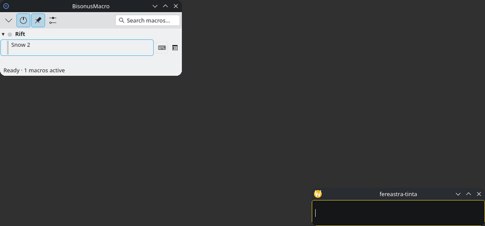
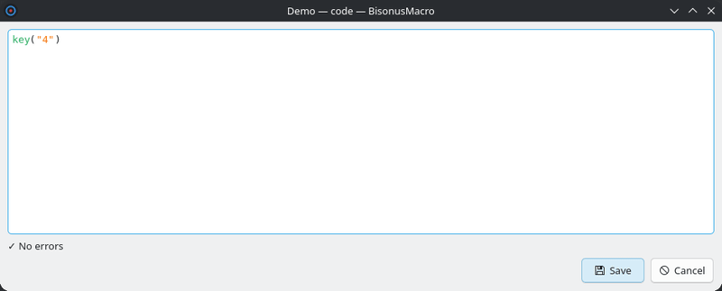
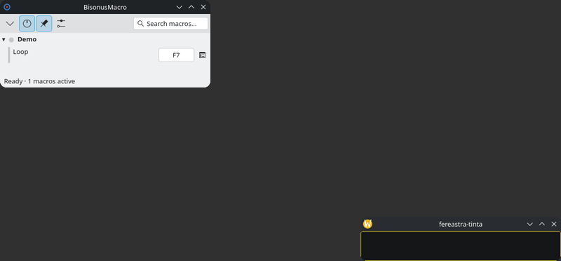

# BisonusMacro

BisonusMacro runs keyboard and mouse macros on Linux. It works only on KDE Plasma 6 with Wayland.

A macro presses keys, types text, moves the mouse and clicks. Each macro is a short script. You start a macro with a click on its row in the panel or with a global key.



The picture shows a test window. Any other window receives the same keys.

## Requirements

- KDE Plasma 6 on a Wayland session.
- KWin 6.7 or newer. The installer checks this.
- `xdg-desktop-portal-kde`. It shows the access window and sends the keys.

## Tested distributions

| Distribution | Result |
|---|---|
| Debian sid | Installed and probed in a container. |
| Fedora 44 | Installed and probed in a container. |
| Arch Linux | Installed and probed in a container. |
| CachyOS | Installed and probed in a container. |
| Debian trixie | Refused by the installer. It has Qt 6.8.2 and KF6 6.13.0. |
| Ubuntu 26.04 | Refused by the installer. It has Qt 6.10.2 and KF6 6.24.0. |
| KDE neon and other derivatives | Untested. |
| Manjaro, EndeavourOS and other Arch derivatives | Untested. The installer accepts them when /etc/os-release has arch in ID_LIKE. |
| Plasma 6.6 or older | Untested. The installer refuses KWin older than 6.7. |

BisonusMacro needs Qt 6.10.2 or newer and KF6 6.30 or newer. These are the libraries of KDE. On Debian, the installer reads the Qt and KF6 versions of your distribution and changes nothing when they are too old. On Fedora, the installer checks only that you run Fedora 44 or newer. On Arch Linux and its derivatives, the installer reads the Qt and KF6 versions from the package database.

## Install

The installer checks your system first. It changes nothing when a check fails.

Run the installer as your user, not as root. It calls `sudo` itself for the steps that write.

On Debian, the installer needs `curl` and `gpg`. Install them first: `sudo apt install curl gpg`.

1. Download `install.sh` and `SHA256SUMS` from the [Releases page](https://github.com/Redaudacious/bisonus-macro/releases).
2. Check that `install.sh` is the published file: `sha256sum --check --ignore-missing SHA256SUMS`. The command must print `install.sh: OK`.
3. Check your system: `bash install.sh --check`
4. Install: `bash install.sh`

`SHA256SUMS.asc`, on the same page, is the signature of `SHA256SUMS`. To check it, import the signing key from the Pages site (`gpg --import bisonus-macro.asc`), then run `gpg --verify SHA256SUMS.asc SHA256SUMS`. Compare the key fingerprint with the one in the notes of the release.

The installer shows its steps and asks `Continue? [y/N]` before it writes.

On a Debian system, you can do the steps by hand. Download the signing key from the Pages site of the project, then add the source.

```bash
sudo install -D -m 0644 bisonus-macro.asc /etc/apt/keyrings/bisonus-macro.asc
printf 'Types: deb\nURIs: https://redaudacious.github.io/bisonus-macro/\nSuites: ./\nSigned-By: /etc/apt/keyrings/bisonus-macro.asc\n' | sudo tee /etc/apt/sources.list.d/bisonus-macro.sources
sudo apt-get update && sudo apt-get install bisonus-macro
```

Before you trust the key, compare its fingerprint with the one in the notes of the release.

On Fedora, use the COPR repository:

```bash
sudo dnf install 'dnf-command(copr)'
sudo dnf copr enable redaudacious/bisonus-macro
sudo dnf install bisonus-macro
```

### On Arch Linux and CachyOS

On Arch Linux and CachyOS, `bash install.sh` checks your system and prints the install commands. It does not install anything.

Install the package from the AUR with an AUR helper:

```bash
paru -S bisonus-macro
```

The command `yay -S bisonus-macro` does the same. You can also install the file from the Releases page:

```bash
sudo pacman -U ./bisonus-macro-0.7.0-1-x86_64.pkg.tar.zst
```

## First start

Start BisonusMacro from the application menu. KDE shows a window that asks for keyboard and mouse control. Accept it once.

After an update to version 0.7.0, KDE asks one more time. Accept it again.

Without this access, all macros are gray. The panel shows the reason and a bar with the button "Ask again". The button asks KDE again.

## Your first macro

A new install has no macros. Click the gear button (⚙) in the toolbar of the panel. The main window opens on the page "Macros". This page shows three cards:

- **A template** loads a set of example macros. You can change them or remove them.
- **Import a file...** opens a .json file. You can also drop a .json file on the page.
- **Create a macro** makes a macro and opens the editor.



The macros use a small scripting language. It types keys and also moves the mouse, clicks and turns the wheel with `mousemove`, `click` and `wheel`. The help window of the program has a full page for it, "Scripting language". Open it from the main window.

## Stopping a macro

A macro that runs can stop in four ways:

1. Press the stop key. Default: Pause. You can change it on the page "Keys".
2. Click "■ Stop" in the panel.
3. Press the global key of the macro again.
4. Choose "Stop macro" in the menu of the tray icon.

The stop key does not work inside a `block`. A `block` blocks the keyboard until it ends. Only the tray item stops a macro there.



### If the keyboard stays off

When you hold Shift, Ctrl, Alt or Super as a macro starts, BisonusMacro turns off that keyboard in KWin for a few milliseconds. A crash in that moment leaves the keyboard off. BisonusMacro turns it on again at the next start. Until then, use another keyboard, or start the program with the mouse from the menu.

If the program does not start, open the on-screen keyboard of Plasma with the mouse. Run this command. It turns on all input devices of KWin:

```bash
for p in $(busctl --user tree org.kde.KWin | grep -o '/org/kde/KWin/InputDevice/event[0-9]*'); do busctl --user set-property org.kde.KWin $p org.kde.KWin.InputDevice enabled b true; done
```

## Uninstall

Remove the settings that BisonusMacro wrote in KDE first. Then remove the package.

1. Quit BisonusMacro from the tray menu.
2. Run `bisonus-macro --cleanup`. You can also click "Remove BisonusMacro from KDE..." on the page "General". The command removes the KWin rules, the KWin scripts and the global keys. It keeps your macros.
3. To remove your macros and settings too, run `bisonus-macro --cleanup --all`. It first saves a backup file in your home folder. Import this file to get your macros back.
4. Remove the package:
   - Debian: `sudo apt remove bisonus-macro`
   - Fedora: `sudo dnf remove bisonus-macro`
   - Arch Linux: `sudo pacman -R bisonus-macro`
   - Or run `bash install.sh --uninstall`. It does all the steps, also for the repository.

If the program does not start, remove the settings by hand:

1. Open System Settings, "Window Management", "Window Rules". Remove the rules "BisonusMacro" and "BisonusMacro on top".
2. Open "Shortcuts" and remove the shortcuts of the component `bisonus-macro`.
3. Remove the KWin scripts: `rm -f ~/.local/share/bisonus-macro/*.js`
4. Remove your macros, if you want: `rm -rf ~/.config/bisonus-macro ~/.config/bisonus-macrorc`

A KWin rule that stays behind matches only a window with the title `BisonusMacro`. It leaves every other window as it is.

## Dependencies

### Run

| Needs | Debian | Fedora | Arch Linux |
|---|---|---|---|
| Access window and keyboard portal | `xdg-desktop-portal-kde` | `xdg-desktop-portal-kde` | `xdg-desktop-portal-kde` |
| KWin | `kwin-wayland` | `kwin` | `kwin` |
| Icons | not needed | `hicolor-icon-theme` | `hicolor-icon-theme` |
| Libraries: Qt 6, KF6, libei | the package pulls them in | the package pulls them in | the package pulls them in |

### Build

| Needs | Debian | Fedora | Arch Linux |
|---|---|---|---|
| Compiler and build tools | `cmake g++ make extra-cmake-modules pkgconf gettext` | `cmake gcc-c++ make extra-cmake-modules gettext` | `cmake extra-cmake-modules gettext base-devel` |
| Qt 6 | `qt6-base-dev` | `qt6-qtbase-devel` | `qt6-base` |
| KF6 | `libkf6globalaccel-dev libkf6xmlgui-dev libkf6config-dev libkf6dbusaddons-dev libkf6i18n-dev libkf6colorscheme-dev libkf6statusnotifieritem-dev libkf6widgetsaddons-dev` | `kf6-kglobalaccel-devel kf6-kxmlgui-devel kf6-kconfig-devel kf6-kdbusaddons-devel kf6-ki18n-devel kf6-kcolorscheme-devel kf6-kstatusnotifieritem-devel kf6-kwidgetsaddons-devel` | `kglobalaccel kxmlgui kconfig kdbusaddons ki18n kcolorscheme kstatusnotifieritem kwidgetsaddons` |
| libei, the keyboard library | `libei-dev` | `libei-devel` | `libei` |

Build with `cmake -B build -S . && cmake --build build`. Test with `ctest --test-dir build --output-on-failure`.

On Arch Linux, `bash packaging/build-arch.sh` builds the package with makepkg in a container.

### Probes and pictures

The desktop probes and the pictures of the help need these tools. The package does not need them.

| Tool | Debian | Fedora |
|---|---|---|
| `ydotool`, to move the mouse and press keys | `ydotool` | `ydotool` |
| `podman`, for the package probes | `podman` | `podman` |
| `ffmpeg`, to make the GIF files | `ffmpeg` | `ffmpeg-free` |
| `spectacle`, to take screenshots | `kde-spectacle` | `spectacle` |
| Python Imaging Library, to cut pictures | `python3-pil` | `python3-pillow` |
| `kscreen-doctor`, to turn the screen off | `kscreen` | `kscreen` |
| `actionlint`, to check the workflows | no package: use the release binary | no package: use the release binary |

## License

BisonusMacro is free software under the GPL-3.0-or-later license. The text is in [LICENSE](LICENSE).

What changed in each version is in the [changelog](CHANGELOG.md).

